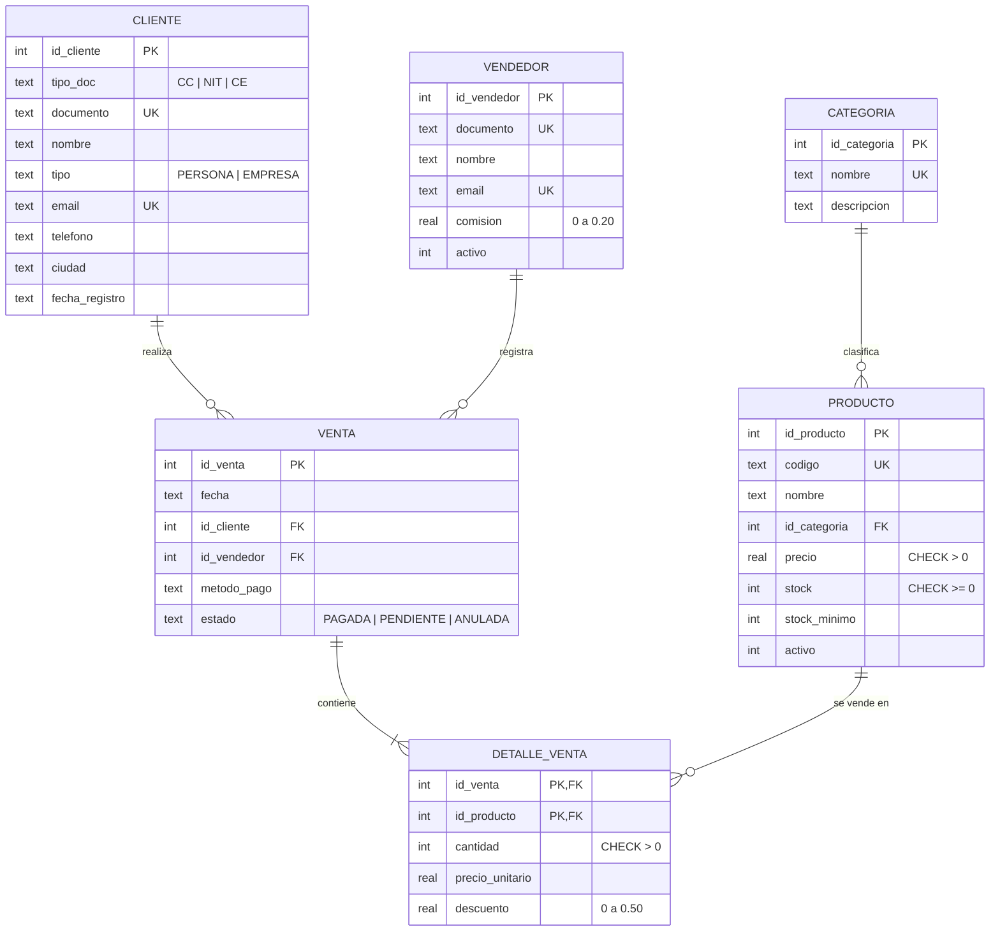

# KStore S.A.S. · Sistema de Gestión de Ventas

**Laboratorio 01 · Bases de Datos**: aplicación que usa una base de datos relacional para gestionar
la venta de productos de una empresa a varios clientes.

- **Lenguaje:** Python 3.9+
- **Interfaz web:** Streamlit, con estilo de terminal (ncurses / menuconfig)
- **Base de datos:** SQLite 3

---

## 1. Estructura del proyecto

```
proyecto_base_datos/
├── app.py                 # Interfaz (menú, módulos, estilo terminal)
├── db.py                  # Capa de acceso a datos, transacciones y bitácora SQL
├── documentos.py          # Validación y formato de CC, CE y NIT colombianos
├── requirements.txt       # Dependencias para instalar / Streamlit Cloud
├── .streamlit/config.toml # Tema de terminal en blanco y negro
├── sql/
│   ├── schema.sql         # DDL: tablas, PK, FK, CHECK, UNIQUE, índices, triggers, vista
│   ├── seed.sql           # Datos de ejemplo (5 categorías, 22 productos, 10 clientes, 15 ventas)
│   ├── consultas.sql      # 13 consultas SQL de reportes (la app las lee de aquí)
│   └── ejemplos_dml.sql   # INSERT / UPDATE / DELETE y pruebas de integridad para la sustentación
└── data/kstore.db      # Se crea solo al iniciar la app (no se sube al repositorio)
```

## 2. Modelo entidad-relación



`DETALLE_VENTA` resuelve la relación **muchos a muchos** entre `VENTA` y `PRODUCTO`. Su clave
primaria es compuesta: `(id_venta, id_producto)`.

## 3. Cómo se cubre cada punto del laboratorio

| Concepto | Dónde se ve |
|---|---|
| Modelo entidad-relación | Módulo **9 Modelo E-R** (diagrama, diccionario de datos y DDL) y el diagrama de arriba |
| Creación de tablas y relaciones | `sql/schema.sql` |
| Claves primarias y foráneas | `PRIMARY KEY` en todas las tablas; `FOREIGN KEY` con `ON DELETE RESTRICT` y `CASCADE` |
| Restricciones de integridad | `NOT NULL`, `UNIQUE`, `CHECK` (precio > 0, stock ≥ 0, formato de CC/CE/NIT, dígito de verificación del NIT…), `DEFAULT` y 6 triggers |
| Consultas SQL | Módulo **7 Reportes SQL** (13 consultas con JOIN, GROUP BY, HAVING, subconsultas, LEFT JOIN, NOT EXISTS) y **8 Consola SQL** |
| Inserción / actualización / eliminación | Módulos Clientes, Productos, Categorías, Vendedores y Ventas (Nuevo / Editar / Eliminar) |
| Transacciones | Registrar una venta = `BEGIN` → `INSERT venta` → `INSERT detalle…` → `COMMIT` (o `ROLLBACK` si algo falla) |

**Documentos de identidad (formato colombiano):**

| Tipo | Regla | Se guarda | Se muestra |
|---|---|---|---|
| CC (cédula de ciudadanía) | 6 a 10 dígitos, sin cero inicial | `1045678912` | `1.045.678.912` |
| CE (cédula de extranjería) | 6 a 7 dígitos, sin cero inicial | `845123` | `845.123` |
| NIT (empresas) | 9 dígitos que empiezan por 8 o 9, más el dígito de verificación | `900123456-8` | `900.123.456-8` |

- El dígito de verificación (DV) del NIT se calcula con el algoritmo módulo 11 de la DIAN. Lo valida
  la restricción `ck_cliente_nit_dv` en la base de datos y también la aplicación, que dice cuál es el
  DV correcto. Si se escribe el NIT sin DV, la aplicación lo calcula sola.
- Los documentos se pueden escribir con o sin puntos. La búsqueda también ignora los puntos.
- Las empresas deben tener NIT y las personas CC o CE (`ck_cliente_doc_tipo`).
- La función SQL `formato_doc(tipo_doc, documento)` se registra desde Python para mostrar los puntos.

**Triggers:**
- `trg_detalle_valida_stock`: no deja vender más unidades de las que hay en stock.
- `trg_detalle_descuenta_stock`: descuenta el inventario al vender.
- `trg_venta_anular`: devuelve el stock al anular una venta.
- `trg_venta_no_reactivar`: una venta anulada no se puede reactivar.
- `trg_venta_eliminar`: devuelve el stock al eliminar una venta que no estaba anulada.
- `trg_detalle_valida_venta`: no deja agregar productos a una venta anulada.

**Vista:** `v_venta_resumen` calcula el subtotal, el IVA (19 %) y el total de cada venta.

## 4. Ejecutar en el computador

```bash
pip install -r requirements.txt
```

```bash
streamlit run app.py
```

Se abre en `http://localhost:8501`. La base de datos se crea sola la primera vez.

## 5. Publicar en la web (Streamlit Community Cloud, gratis)

1. Crear un repositorio en GitHub y subir esta carpeta. `data/` no se sube porque está en `.gitignore`.
2. Entrar a <https://share.streamlit.io> con la cuenta de GitHub.
3. **Create app** → elegir el repositorio, la rama `main` y el archivo `app.py`.
4. En **Advanced settings**, elegir Python 3.11 o 3.12.
5. **Deploy**. En uno o dos minutos queda una URL como `https://kstore.streamlit.app`.

> En Streamlit Cloud el disco no es permanente: cuando la app se reinicia, la base vuelve a los
> datos de ejemplo. Para la demo es una ventaja, porque siempre arranca limpia. También se puede
> reiniciar a mano desde **0 Sistema → Reiniciar base de datos**.

## 6. Uso de la interfaz

| Tecla | Acción |
|---|---|
| `0`–`9` | Abrir la opción del menú |
| `↑` `↓` | Moverse por el menú |
| `Enter` | Abrir la opción seleccionada |
| `Esc` | Volver al inicio |

- El panel **Mensajes · bitácora SQL** muestra cada sentencia SQL que ejecuta el sistema, incluidas
  `BEGIN`, `COMMIT` y `ROLLBACK`. Sirve para mostrar en la sustentación lo que pasa por dentro.
- Los nombres de los integrantes se editan en `app.py`, en la lista `INTEGRANTES`.

## 7. Guion sugerido para la sustentación

1. **Inicio**: presentar la empresa y el panel de estado.
2. **Modelo E-R**: explicar las entidades, las cardinalidades y la tabla intermedia `DETALLE_VENTA`.
3. **Clientes → Nuevo**: crear un cliente. Luego repetir el documento para mostrar el error **UNIQUE**.
4. **Clientes → Eliminar** un cliente que tiene ventas: se ve el error **FOREIGN KEY (RESTRICT)**.
5. **Ventas → Nueva venta**: agregar productos, confirmar y ver la factura. En la bitácora aparece la
   transacción y en **Productos** el stock ya descontado.
6. **Ventas → Gestionar → Anular**: el trigger devuelve el stock.
7. **Reportes SQL**: recorrer las consultas y abrir "Ver SQL".
8. **Consola SQL**: ejecutar los ejemplos de error (CHECK, FK, duplicados).
