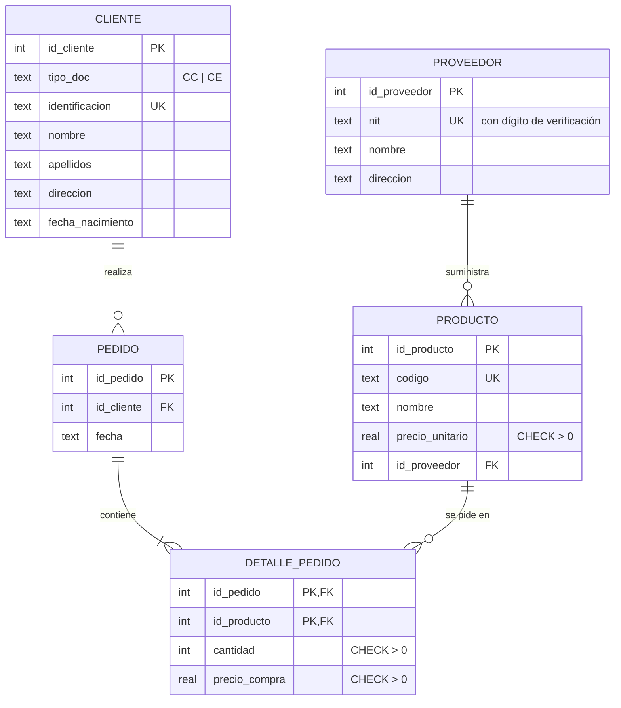

# KStore S.A.S. · Sistema de Pedidos

**Laboratorio 01 · Bases de Datos.** Sistema de información sobre una base de datos relacional para una
empresa que vende productos a varios clientes, con productos suministrados por proveedores.

- **Lenguaje y framework:** Python 3.9+ con **Flask**
- **Motor de base de datos:** **SQLite 3** (driver `sqlite3`, incluido en Python)
- **Interfaz:** web, con estilo de terminal (ncurses / menuconfig) y manejo con teclado
- **Integrantes:** Andrés Parejo, Valeria Flórez, Víctor Mendoza, Santiago Molina, Sara Ibáñez

---

## 1. Enunciado

> Una empresa vende productos a varios clientes. Se necesita conocer los datos personales de los clientes
> (identificación, nombre, apellidos, dirección y fecha de nacimiento). Cada producto tiene un nombre y un
> código, así como un precio unitario. Un cliente puede comprar varios productos a la empresa, y un mismo
> producto puede ser comprado por varios clientes. Los productos son suministrados por diferentes
> proveedores. Un producto sólo puede ser suministrado por un proveedor, y un proveedor puede suministrar
> diferentes productos. De cada proveedor se desea conocer el nit, nombre y dirección.

## 2. Diagrama entidad-relación



- **PROVEEDOR 1 : N PRODUCTO.** Un proveedor suministra varios productos y cada producto tiene un solo proveedor.
- **CLIENTE N : M PRODUCTO.** Se resuelve con **PEDIDO** (cada compra de un cliente) y **DETALLE_PEDIDO**
  (los productos de cada pedido, con la cantidad y el precio de compra).

## 3. Modelo relacional

Subrayado = clave primaria · `#` = clave foránea

- PROVEEDOR (<u>id_proveedor</u>, nit, nombre, direccion)
- CLIENTE (<u>id_cliente</u>, tipo_doc, identificacion, nombre, apellidos, direccion, fecha_nacimiento)
- PRODUCTO (<u>id_producto</u>, codigo, nombre, precio_unitario, #id_proveedor → PROVEEDOR)
- PEDIDO (<u>id_pedido</u>, #id_cliente → CLIENTE, fecha)
- DETALLE_PEDIDO (<u>#id_pedido</u> → PEDIDO, <u>#id_producto</u> → PRODUCTO, cantidad, precio_compra)

## 4. Restricciones de integridad

| Restricción | Dónde |
|---|---|
| Claves primarias | Todas las tablas. `DETALLE_PEDIDO` usa clave compuesta `(id_pedido, id_producto)`. |
| Claves foráneas | `ON DELETE RESTRICT`: no se borra un cliente con pedidos, un proveedor con productos ni un producto ya pedido. `ON DELETE CASCADE`: al borrar un pedido se borra su detalle. |
| `UNIQUE` | NIT del proveedor, identificación del cliente, código del producto. |
| `CHECK` | Precio > 0, cantidad > 0, formato de CC (6–10 dígitos) y CE (6–7), NIT `900123456-8` con **dígito de verificación de la DIAN**, fecha de nacimiento real. |
| `NOT NULL` | Todos los datos que pide el enunciado. |
| Vista | `v_pedido_resumen` calcula el total de cada pedido. |

## 5. Menú del programa

| Tecla | Opción | Qué hace |
|---|---|---|
| `1` | Inicio | Estado de la base de datos y últimos pedidos |
| `2` | Clientes | Insertar, actualizar, borrar y buscar clientes |
| `3` | Productos | Insertar, actualizar, borrar y buscar productos |
| `4` | Proveedores | Insertar, actualizar, borrar y buscar proveedores |
| `5` | Pedidos | Un cliente realiza un pedido de varios productos (transacción); ver y eliminar pedidos |
| `6` | Consultas | Las 4 consultas pedidas (ver tabla abajo) |
| `7` | Consola SQL | Ejecutar SQL directamente (extra) |
| `8` | Modelo E-R | Diagrama E-R, modelo relacional, diccionario de datos y script de creación |
| `0` | Sistema | Integrantes, descargas y reiniciar la base de datos |

**Consultas** (`sql/consultas.sql`):

1. Clientes y la cantidad de pedidos realizados.
2. Clientes que no realizaron ningún pedido.
3. Nombre del cliente, nombre del producto, cantidad comprada, precio de compra y proveedor.
4. Proveedores con los productos suministrados.

Teclado: `0`–`9` abren una opción, `↑` `↓` mueven por el menú, `Enter` abre, `Esc` vuelve al inicio y
`Ctrl+Enter` ejecuta la consola SQL. El panel **Mensajes · bitácora SQL** muestra cada sentencia que se ejecuta.

## 6. Estructura del proyecto

```
proyecto_base_datos/
├── app.py              # Flask: rutas, menú, CRUD, pedidos, consultas
├── db.py               # Acceso a SQLite, transacciones y bitácora SQL
├── documentos.py       # Validación y formato de CC, CE y NIT colombianos
├── templates/          # Pantallas HTML (Jinja2)
├── static/             # terminal.css y terminal.js (estilo y atajos de teclado)
├── sql/
│   ├── schema.sql      # Script de creación de tablas (DDL)
│   ├── seed.sql        # Datos de ejemplo
│   ├── consultas.sql   # Las 4 consultas del laboratorio
│   └── ejemplos_dml.sql# INSERT / UPDATE / DELETE y pruebas de integridad
├── requirements.txt
└── render.yaml         # Despliegue en Render
```

La base de datos `data/kstore.db` se crea sola la primera vez con `schema.sql` y `seed.sql`.

## 7. Ejecutar en el computador

```bash
pip install -r requirements.txt
```

```bash
python app.py
```

Abrir `http://localhost:5000`.

## 8. Publicar en la web (Render, gratis)

1. Subir el proyecto a GitHub.
2. Entrar a <https://render.com> con la cuenta de GitHub → **New** → **Blueprint** → elegir el repositorio.
   Render lee `render.yaml` y crea el servicio `kstore-pedidos`.
3. En unos minutos queda una URL como `https://kstore-pedidos.onrender.com`.

En el plan gratuito, el servicio se duerme tras 15 minutos sin uso; la primera visita después tarda cerca de
un minuto. El disco no es permanente: al reiniciarse, la base vuelve a los datos de ejemplo.
